# School Library

[](https://github.com/AskhatAmankulov/school-library-project/actions/workflows/tests.yml)

A web app for running a school library. Students look up books, see whether a copy is on the shelf and where it stands, and keep track of what they've borrowed. The librarian issues and returns books, sees what's overdue, and manages the catalogue and the student list.

Built with PHP and MySQL, no framework. Runs on XAMPP or with one Docker command.

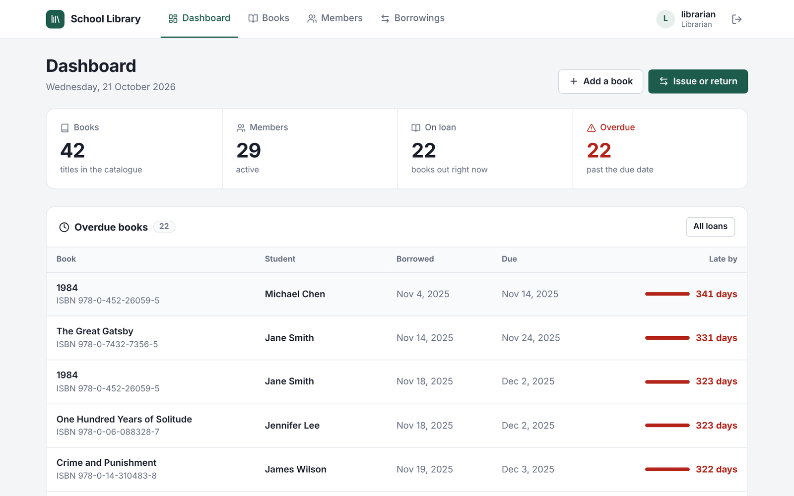

## Try it

### With Docker (one command)

Needs [Docker Desktop](https://www.docker.com/products/docker-desktop/).

```bash
git clone https://github.com/AskhatAmankulov/school-library-project.git
cd school-library-project
docker compose up
```

Open **http://localhost:8080** and log in with one of the accounts below. The database fills itself with sample data on the first start. Stop with `Ctrl+C`; `docker compose down -v` deletes the data so the next start is fresh.

### With XAMPP

1. Put the project in `C:\xampp\htdocs\lib`:
   ```
   cd C:\xampp\htdocs
   git clone https://github.com/AskhatAmankulov/school-library-project.git lib
   ```
2. In the XAMPP Control Panel, start **Apache** and **MySQL**.
3. Open http://localhost/phpmyadmin and create a database named **`library`**.
4. Select `library`, open the **Import** tab and import these files, in this order:
   1. `library.sql`: tables and sample data
   2. `add_users_table.sql`: login accounts
   3. `fix_data.sql`: repairs copy counts and a few damaged values in the sample data
5. Open http://localhost/lib

Already have the database from an earlier version? Import only the files you haven't imported yet. `add_users_table.sql` and `fix_data.sql` are safe to import again.

## Accounts

| Username | Password | Role |
|---|---|---|
| `admin` | `admin123` | Admin |
| `librarian` | `librarian123` | Librarian |
| `user` | `user123` | Student |
| `askhat`, `emma`, `liam`, `sophia`, `noah` | `123` | Student |

New students can also create their own account on the sign-up page.

## What it does

### For students

| | |
|---|---|
| 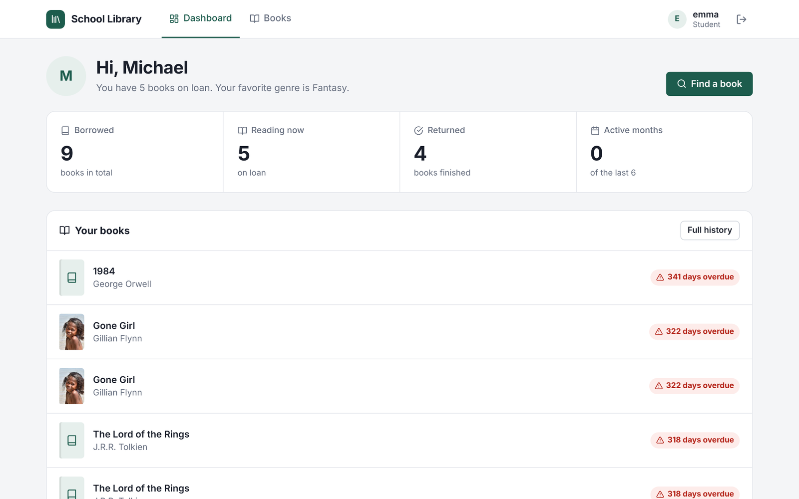 | **Dashboard.** Books on loan with due dates ("Due in 2 days", "5 days overdue"), reading stats and favourite genre. |
| 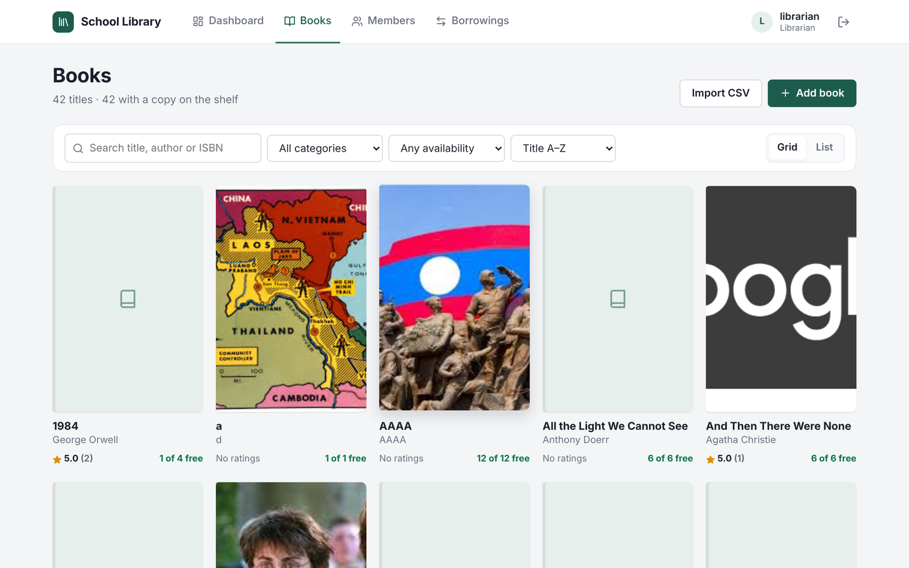 | **Catalogue.** Search by title, author or ISBN as you type (works in Kazakh and Russian too), filter by category and by "on the shelf now", sort, grid or list view. |
| 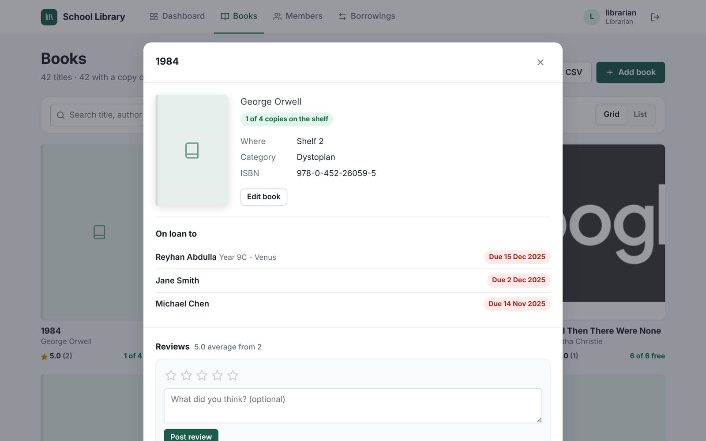 | **Book page.** Shelf and row, how many copies are free, reviews, and a 1–5 star rating form. Staff also see who has the book. |
| 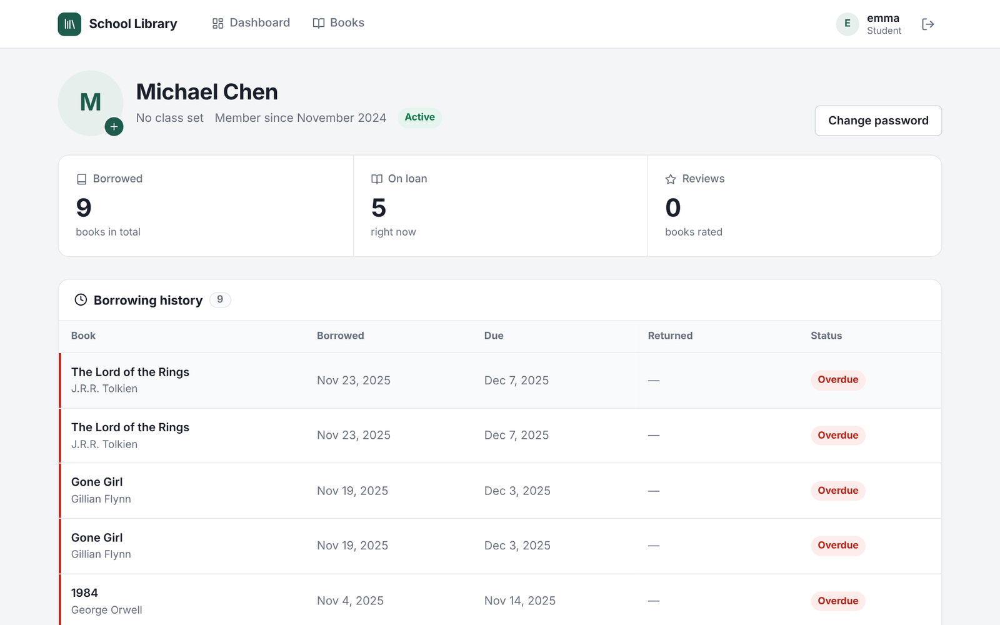 | **Profile.** Full borrowing history, own reviews, photo and password. |

### For the librarian

| | |
|---|---|
| 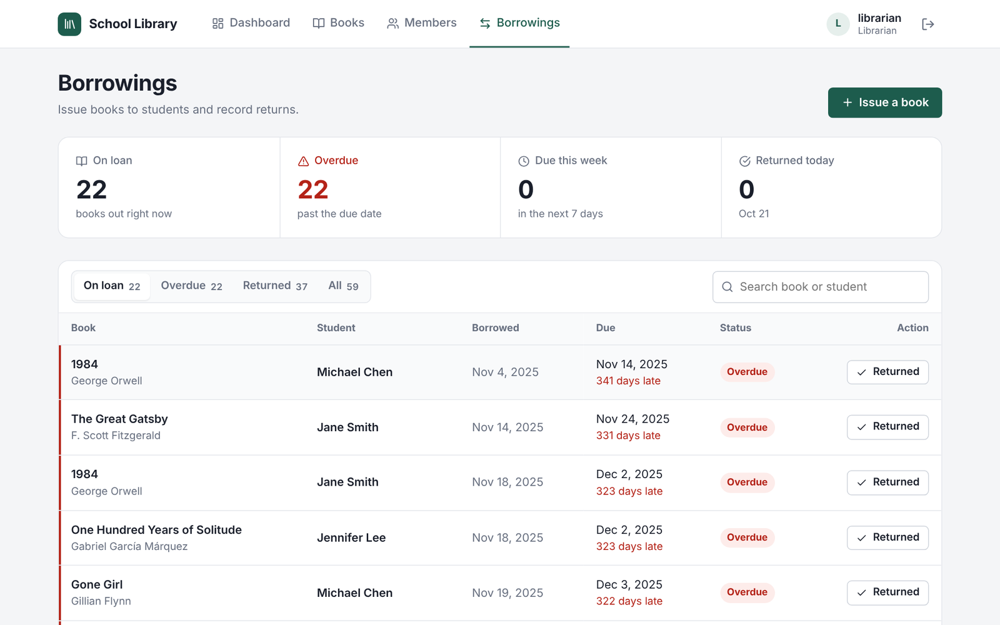 | **Borrowings.** Tabs for on loan / overdue / returned with counts, search, one-click return. |
| 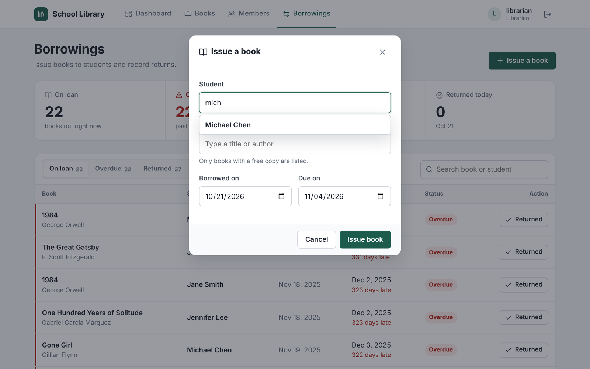 | **Issue a book.** Type part of a student's name or class and part of a title; only books with a free copy are offered. |
| 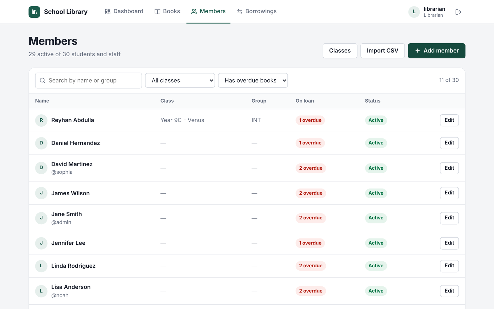 | **Members.** Search, filter by class or "has overdue books", add and edit students, import a class list from CSV (Excel files with `;` work too). |
| 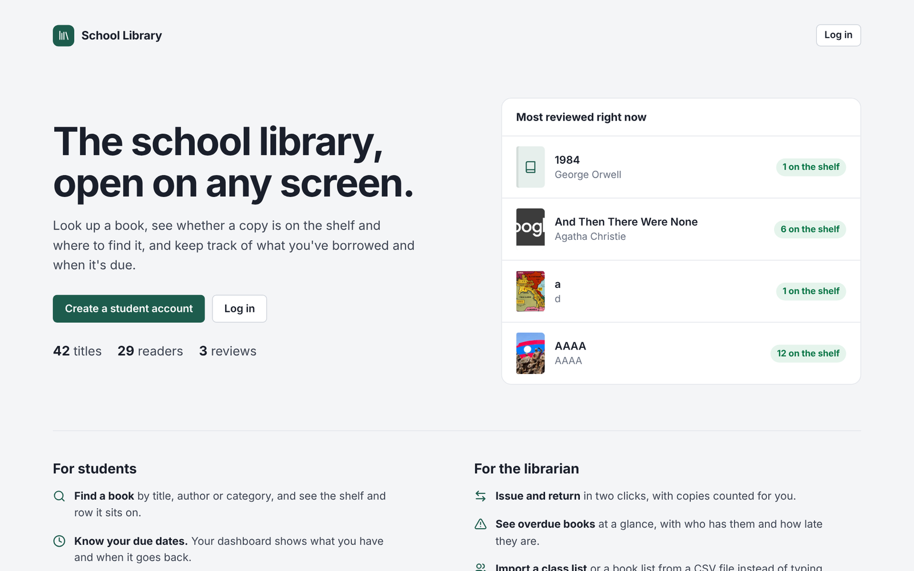 | **Welcome page** for visitors who aren't logged in, with live numbers from the catalogue. |

It also works on phones:

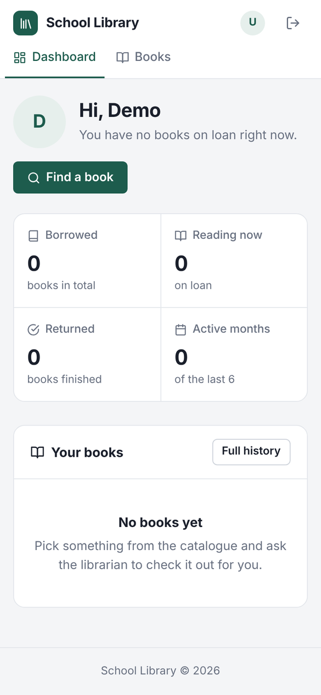 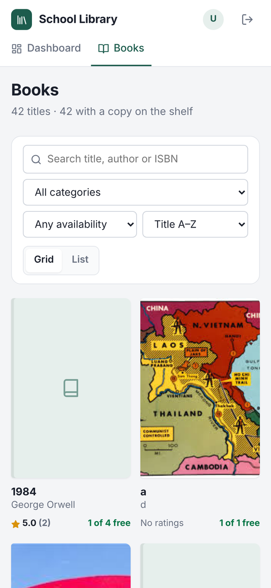

### Who can do what

| Action | Student | Librarian | Admin |
|---|:-:|:-:|:-:|
| Browse books, write reviews | ✅ | ✅ | ✅ |
| Own profile and history | ✅ | ✅ | ✅ |
| Add and edit books, import books from CSV | ❌ | ✅ | ✅ |
| Issue and return books | ❌ | ✅ | ✅ |
| See students and their profiles | ❌ | ✅ | ✅ |
| Add and edit students, import students from CSV | ❌ | ✅ | ✅ |
| Delete books and students | ❌ | ❌ | ✅ |

Permissions are checked on the server for every page and every request, not just by hiding buttons (`auth_check.php`).

## Tests

Every push runs the full test suite on GitHub ([Actions tab](https://github.com/AskhatAmankulov/school-library-project/actions)): it starts the project with `docker compose up`, opens it in a real browser (Chromium) and checks:

| Test file | What it checks |
|---|---|
| `tests/test_functional.py` | **155 checks.** Every feature as admin, librarian, student and guest. Types into every search box letter by letter and compares the result with the database; every filter and sort; issuing and returning (copy counts must add up); adding and editing books, members and reviews; CSV imports; registration and login; permissions; Kazakh/Russian text. |
| `tests/test_bad_input.py` | **171 checks.** Bad input on every endpoint: missing or fake IDs, letters instead of numbers, very long text, impossible dates, broken JSON, wrong request methods. The site must answer with a message, never crash. |
| `tests/test_click_everything.py` | Opens every page as every role and clicks every button and dialog. Fails on any JavaScript error, PHP error, server error or broken link. |

The workflow also fails if PHP writes a single warning to the server log.

### Run the tests yourself

With the project running in Docker:

```bash
pip install -r tests/requirements.txt
python -m playwright install chromium
python tests/run_all.py
```

The tests add, change and delete data, and put the sample data back before each file starts, so run them against Docker or a copy, not a real library. For XAMPP set `BASE_URL=http://localhost/lib DB_PORT=3306 DB_PASS=` first (all settings are in `tests/helpers.py`).

## How it's built

- **PHP 8** with mysqli/PDO prepared statements, **MySQL/MariaDB**, plain HTML/CSS/JavaScript; no framework or build step.
- **Accounts:** passwords hashed with `password_hash`; sessions end after an hour without activity.
- **Safety:** user input reaches SQL only through prepared statements or as numbers cast with `(int)`; all output is escaped (including text inserted by JavaScript); uploaded images are checked by content, not by name; `.htaccess` blocks direct access to `.sql` files and `includes/`.
- **Data you can trust:** issuing and returning run in a transaction, so free-copy counts can't go wrong even if two librarians click at once; a member with books still on loan can't be deleted.
- **Design:** one stylesheet (`css/style.css`) with a small design system; icons are inline SVG, so the site works offline.

## Project structure

```
├── index.php                 Dashboard (staff view / student view)
├── books.php                 Catalogue, book page, add/edit, CSV import
├── borrowings.php            Issue and return (staff)
├── members.php               Students, classes, CSV import (staff)
├── profile.php               History, reviews, photo, password
├── landing.php               Welcome page
├── login.php, register.php, logout.php
├── get_*.php, update_*.php, delete_*.php, search_*.php,
│   submit_review.php, import_csv.php     Data requests used by the pages
├── auth_check.php            Login check and role helpers
├── config.php                Database connection (XAMPP defaults, Docker via env)
├── includes/                 Header, footer, icons, input checks, class settings
├── css/, js/                 Styles and shared scripts
├── uploads/                  Book covers and profile photos
├── library.sql, add_users_table.sql, fix_data.sql   Database
├── Dockerfile, docker-compose.yml                   One-command setup
├── tests/                    Automated browser tests
└── .github/workflows/        Runs the tests on every push
```

## Troubleshooting

- **"Database connection failed"**: MySQL isn't running. In XAMPP, start it from the Control Panel (as Administrator if it won't start).
- **"The users table is missing"**: import `add_users_table.sql` (step 4).
- **Page not found**: check the files are in `C:\xampp\htdocs\lib` and Apache is running.
- **Docker says port 8080 or 3307 is in use**: change the left-hand port in `docker-compose.yml`, e.g. `"8081:80"`.
